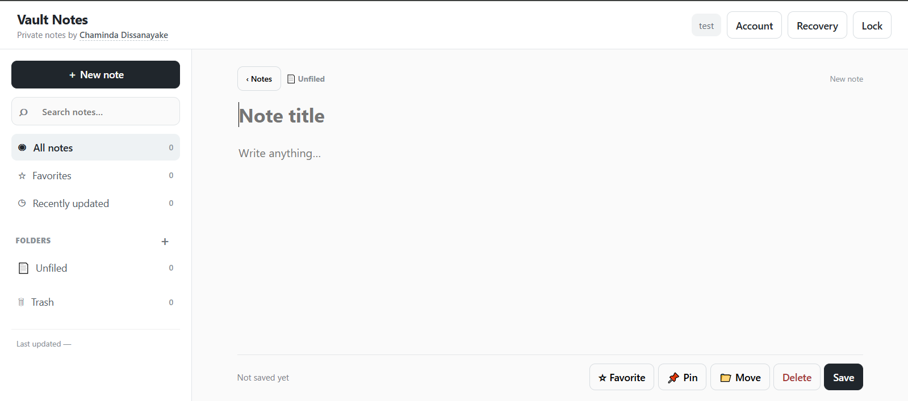
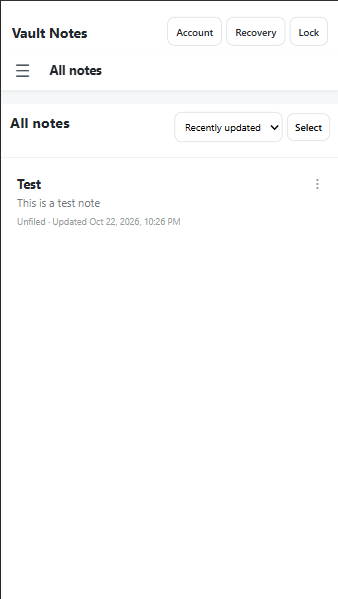
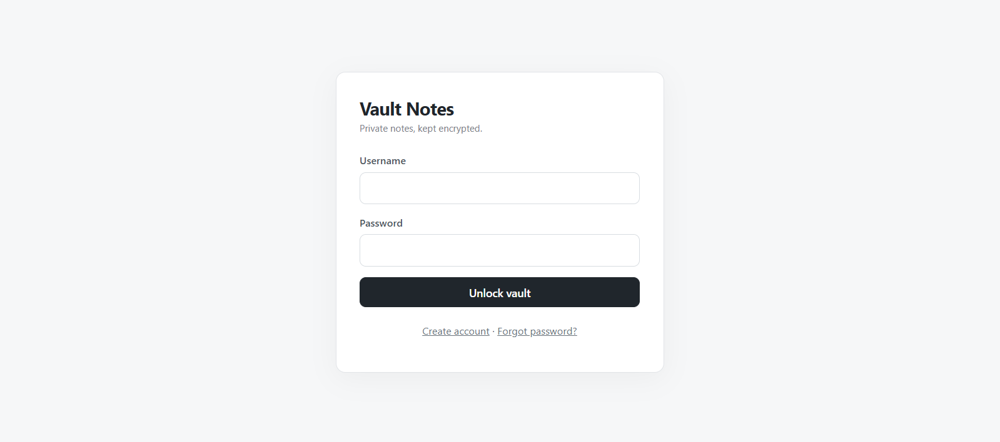
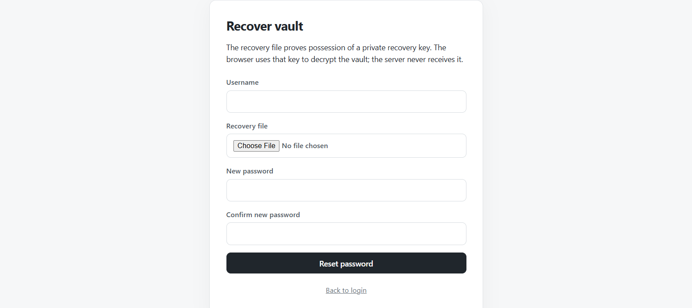

# Vault Notes

**A privacy-focused personal notes application with browser-side encryption.**

Built by **Chaminda Dissanayake** · [GitHub](https://github.com/Chaminda-Dissanayake)

Vault Notes is a web-based notes workspace built with PHP, SQLite, and JavaScript. It encrypts note titles, note bodies, and folder names in the browser before sending them to the server. The goal is to explore how an encrypted notes application can still support familiar organization and productivity features.

> **Security note:** This is a personal development project, not an independently audited security product. Read the [security model and limitations](#security-model-and-limitations) before storing sensitive information.

## Features

- **Encrypted notes and folders:** Note titles, bodies, and folder names are encrypted on the client.
- **Local search:** Search note titles, bodies, and decrypted folder names in your browser, with results scoped to the current folder or view.
- **Organize your workspace:** Create, rename, and delete folders; keep notes unfiled; move individual notes or multiple selected notes between folders.
- **Stay on top of your notes:** Favorites, pinned notes, a recently updated view, sorting, previews, and timestamps.
- **Recover deleted work:** Move notes to Trash, restore them, or permanently delete them.
- **Keyboard shortcuts:** `Ctrl/Cmd + K` for search and `Ctrl/Cmd + N` for a new note.
- **Responsive interface:** A multi-pane desktop workspace that adapts to smaller screens with mobile navigation and a full-screen editor.
- **Editing feedback:** Unsaved-change indicator and note-level activity information.

## Technology

| Layer | Technology |
| --- | --- |
| Server | PHP |
| Database | SQLite via PDO (WAL mode) |
| Browser | JavaScript, HTML, CSS |
| Client-side cryptography | Web Crypto API |
| Auth password hashing | Argon2id |

## How encryption works

1. The user signs in and unlocks their vault in the browser.
2. The browser encrypts note titles, bodies, and folder names before sending them to the PHP API.
3. The server stores encrypted values in SQLite, together with the metadata required to manage the workspace.
4. The browser decrypts notes locally for viewing, editing, and searching.

The project uses the following mechanisms:

| Purpose | Implementation |
| --- | --- |
| Authenticated content encryption | AES-256-GCM via Web Crypto |
| Encryption nonce | Fresh 96-bit IV per operation |
| Password-based key derivation | PBKDF2-HMAC-SHA-256, 600,000 iterations |
| Authentication verifier | Argon2id (`memory_cost=65536`, `time_cost=3`, `threads=1`) |
| Recovery-key signatures | P-256 ECDSA |
| Domain separation | Distinct AES-GCM associated-data labels for titles, bodies, and folder names |

Associated-data labels used by the application are `note-title-v3`, `note-body-v3`, and `folder-name-v3`.

## Getting started

### Requirements

- PHP with SQLite support (`pdo_sqlite`) and Argon2id password-hashing support
- A modern browser with support for the Web Crypto API
- A PHP-capable local or web server
- Write permissions for the application's `data/` and `recovery/` directories

### Local installation

1. Clone the repository:

   ```bash
   git clone https://github.com/Chaminda-Dissanayake/zero-knowledge-vault-notes.git
   cd zero-knowledge-vault-notes
   ```

2. Check `config.php` for the database path, recovery directory, and application settings. The default SQLite database is created at `data/vault-v3.sqlite`.

3. For local evaluation, start PHP's development server from the repository directory:

   ```bash
   php -S localhost:8000
   ```

4. Open `http://localhost:8000` in your browser and create an account.

**Deployment warning:** PHP's built-in server is for local development, not production. The repository includes Apache `.htaccess` rules, but these do not apply to PHP's development server or to Nginx. For any public deployment, configure the web server to prevent direct access to `data/`, `recovery/`, SQLite files, and other private resources. Use HTTPS, appropriate filesystem permissions, and backups. Do not assume the sample local setup is safe for hosting real secrets.

## Security model and limitations

Vault Notes follows a **zero-knowledge-style application design** for note content: in its intended operation, the PHP server receives ciphertext rather than plaintext titles, bodies, and folder names.

**What the server can still observe:** note and folder IDs, timestamps, encrypted payload sizes, favorite/pin flags, folder membership, and other account or request metadata. Folder membership is represented using server-side folder IDs so moving a note does not require re-encrypting its content.

**What this design does not protect against:**

- A compromised server that changes the JavaScript or HTML delivered to users. Malicious code could capture credentials or decrypted vault data.
- Malicious browser extensions, cross-site scripting, or a compromised client device.
- Metadata exposure as described above.
- Loss of data due to device, hosting, or backup failures.

Client-side keys and decrypted content exist within the browser while the vault is in use. Browser session storage, where used, should **not** be treated as a hardware-protected or inaccessible memory boundary.

**The project has not undergone an independent security audit.** Its use of established algorithms does not, by itself, establish that the complete application is secure.

## Data and upgrade behavior

- SQLite initializes the required tables and indexes through `db.php`.
- For existing v3 databases, the v3.1 migration adds folders and note fields for folder association, favorites, pins, and soft deletion.
- Existing notes remain active and unfiled following the migration; note content is not re-encrypted as part of it.
- Moving a note to Trash sets `deleted_at`. Permanently deleting it removes the record from Trash.
- Deleting a folder moves its notes to Unfiled rather than deleting them.
- Stored Unix timestamps are displayed in the browser's local timezone.

## Responsive workspace

On desktop, the application uses a three-pane notes workspace. On smaller displays, navigation becomes a slide-out drawer and the editor occupies the screen. Search, sorting, selection, and folder-management controls remain available on mobile layouts. The responsive update does not change the encryption or storage model.

## Screenshots

### Desktop notes workspace

Create and organize encrypted notes in a spacious desktop editor, with quick access to search, folders, favorites, and note actions.



### Mobile notes list

The responsive interface makes it possible to browse and manage notes on smaller screens.



### Vault login

Users can sign in to unlock their encrypted vault.



### Recovery workflow

The recovery screen lets a user select their recovery file and set a new password. Keep recovery files private and never commit real recovery keys or credentials.



> Screenshots show example application screens, not a security audit or evidence of encryption guarantees.

## Feedback and contributions

This project is available for learning, code review, and experimentation. Suggestions, bug reports, and constructive feedback are welcome through [GitHub Issues](https://github.com/Chaminda-Dissanayake/zero-knowledge-vault-notes/issues).

## License

Licensed under the [MIT License](LICENSE).

---

Developed by **[Chaminda Dissanayake](https://github.com/Chaminda-Dissanayake)**.
